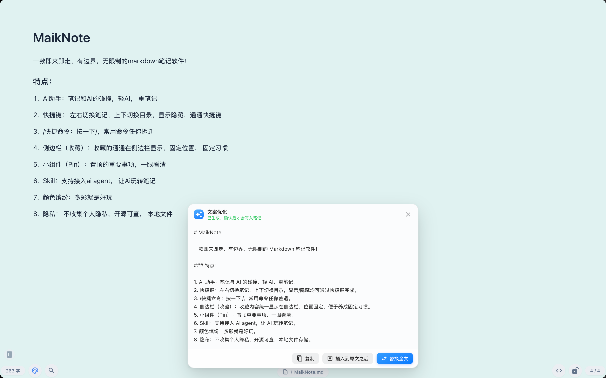
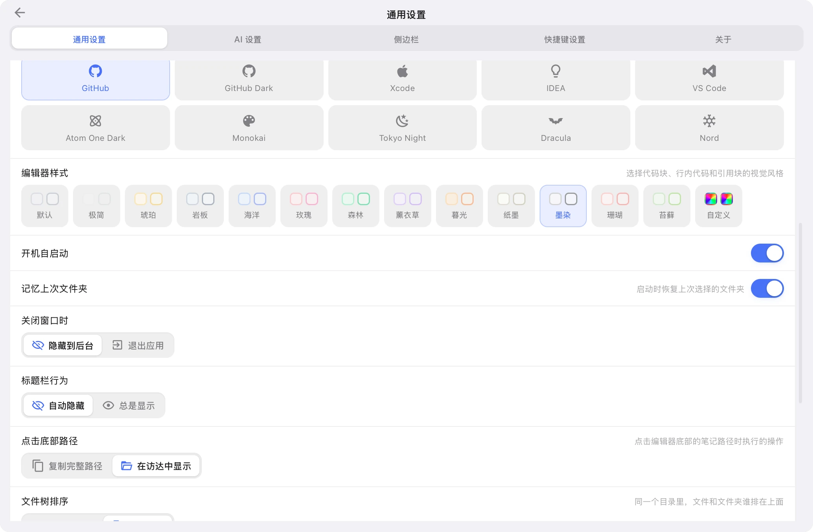
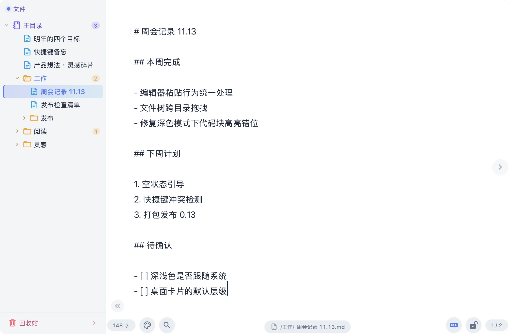
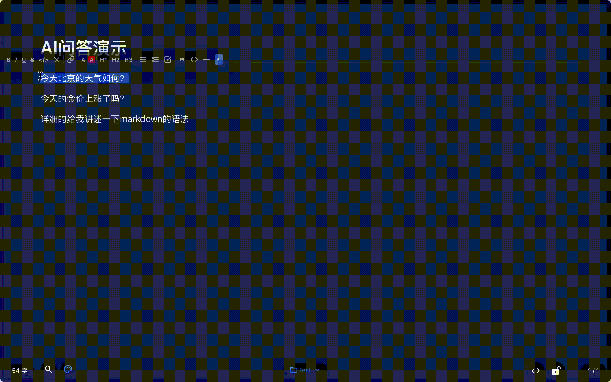

<div align="right">
  <a href="README_EN.md">English</a>
</div>

<div align="center">
  <h1>MaikNote</h1>
  <p>一款 macOS 原生的 AI Markdown 悬浮便签应用</p>
  <p>
    
    
    
    
    
  </p>
</div>

---

## 简介

全局快捷键随叫随到，所见即所得写 Markdown，笔记以纯 `.md` 文件落在 iCloud 目录里天然多设备同步，并内置 AI 改写与桌面笔记卡片。灵感来自 [Antinote](https://antinote.io/)，在其基础上深度整合了 AI 能力。本项目完全通过 vibe coding 方式开发。

官网与下载：[maiknote.91kfc.vip](https://maiknote.91kfc.vip)

## 设计理念

**召之即来，挥之即去** · 全局快捷键随时唤起 / 隐藏 ｜ **所见即所得** · 实时渲染 Markdown，无需切换预览 ｜ **如无必要，勿增实体** · 极简界面，专注内容本身

## 主要界面



|               文件夹               |              搜索              |              主题              |
|:-------------------------------:|:----------------------------:|:----------------------------:|
|  |  |  |

|              配色               |              快捷键              |              源码模式              |
|:----------------------------:|:-----------------------------:|:------------------------------:|
|  |  |  |

## AI 演示

> 有选中文字时，只把选中的内容发给 AI；没有选中时，发送整篇笔记。



## 功能特性

**编辑** — Notion 风格块菜单、块拖拽、`/` 斜杠命令；表格 / 待办 / 代码高亮 / 图片与行内样式；源码模式（`Cmd+/`）与源码内搜索；链接自动转卡片预览；字号、Tab 空格数与编辑器样式预设；防抖自动保存，空段落与中文输入法往返无损。

**窗口与桌面** — 无边框悬浮窗 + 原生毛玻璃，透明度 / 置顶 / 层级可调；按显示器与 Space 记忆窗口位置；**桌面笔记卡片**（`Cmd+Shift+D`，可拖动缩放、勾选回写正文、三档图层）；**边缘面板**（贴边小白条，四向触发、可调宽度与颜色）；关闭行为可选隐藏或退出，支持开机自启。

**组织与检索** — 多级文件夹文件树，同级拖拽排序、拖进文件夹自动搬运；收藏与固定分组；回收站、笔记锁定；磨砂玻璃全局搜索（↑↓ / Enter / Esc）；文件树字号 11–18px 可调；导入导出 Markdown。

**AI 与集成** — 右键 AI 优化（选中即局部改写）；自定义助手与提示词，默认接 DeepSeek API；MCP 联网搜索；`/ip` 查出口 IP；内置 `maiknote-guide` Skill，一键软链到 Claude Code / Codex / DSH / Gemini CLI / `~/.agents`。

**外观与隐私** — 深色 / 浅色 / 跟随系统，多套代码高亮主题；笔记背景色与默认背景；首启隐私承诺页；设置内可检测「完全磁盘访问」、管理 Skill 软链接；笔记就是 iCloud 里能直接看到、直接改的 `<标题>.md`。

## 快捷键

| 快捷键 | 功能 | 快捷键 | 功能 |
|:---|:---|:---|:---|
| `Cmd+Opt+A` | 唤起 / 隐藏主窗口（全局） | `Cmd+Shift+D` | 钉到桌面 / 移除 |
| `Shift+Opt+Cmd+A` | 窗口居中（全局） | `Cmd+F` | 搜索笔记 |
| `Cmd+N` | 新建笔记 | `Cmd+,` | 打开设置 |
| `Cmd+Shift+N` | 在当前笔记之前新建 | `Cmd+L` | 锁定 / 解锁笔记 |
| `Cmd+Backspace` | 删除当前笔记 | `Cmd+/` | 切换源码模式 |
| `Cmd+Shift+P` | 窗口置顶 | `Cmd+\` | 展开 / 收起侧栏 |
| `Cmd+[` / `Cmd+]` | 上一条 / 下一条笔记 | `Cmd+W` | 隐藏窗口 / 退出应用 |
| `Cmd+Opt+[` / `Cmd+Opt+]` | 上一个 / 下一个目录 | `Esc` | 关闭搜索、从设置返回 |

> 除全局快捷键外都可在「设置 → 快捷键」中改键、留空或恢复默认；触摸板左右滑动也可切换笔记。

## 数据存储

笔记以 Markdown 文件存放在 iCloud，文件名即标题，文件夹即目录：

```
~/Library/Mobile Documents/com~apple~CloudDocs/MaikNote/
├── metadata.json        # 索引（收藏、锁定、回收站、排序）
├── assistants.json      # AI 助手配置
├── 灵感.md
└── 工作/
    └── 周报.md
```

旧版 `note_<uuid>.md` 扁平布局会在启动时自动迁移。

## 技术栈

Tauri 2.x + Vue 3.x + TypeScript · Tiptap 2.x（Notion 风格块操作）· Pinia · UnoCSS · 本地 `.md` 文件（iCloud）· DeepSeek / OpenAI 兼容接口 · vue-i18n（中文 / English）

## 开发指南

需要 Node.js 20+、Rust 1.70+、macOS 12+。

```bash
npm install
npm run tauri dev                                          # 开发
npm run tauri build -- --target aarch64-apple-darwin       # 构建 Apple Silicon
npm run tauri build -- --target x86_64-apple-darwin        # 构建 Intel
```

官网单独放在 `site/`，纯静态（无构建步骤），可独立部署。

## 常见问题

**提示「无法打开」** — 应用未做 Apple 公证，先解除隔离：`sudo xattr -r -d com.apple.quarantine /Applications/MaikNote.app/`

**Finder 里看不到笔记** — 到「设置 → 隐私与安全性 → 完全磁盘访问」勾选 MaikNote，再点设置页的「重启 App」生效。

## 许可协议

**版权所有 © 2025-2026 MaikNote** · 本软件仅供个人学习、研究和私人使用，禁止任何商业用途；按「原样」提供，不提供任何保证。

- ✅ 个人学习、研究、私人使用；修改源码供个人使用；分享给他人个人使用（保留版权声明）
- ❌ 任何商业使用、在商业产品或服务中集成、销售 / 转让 / 授权、去除或篡改版权信息
