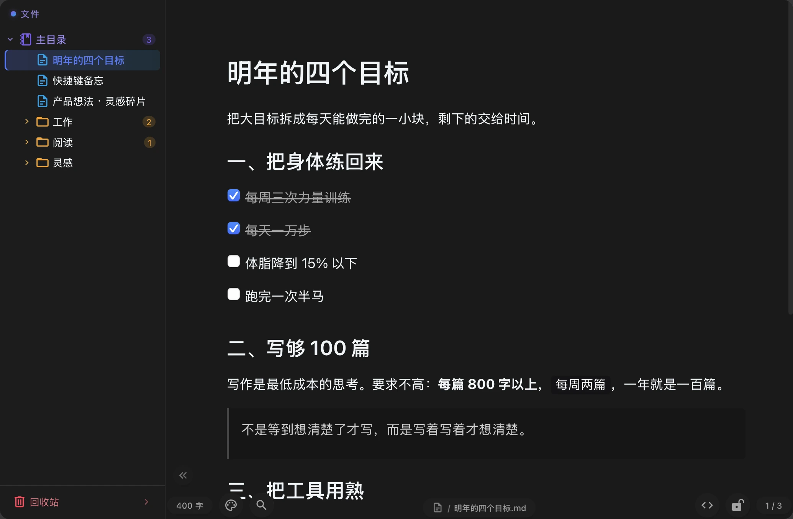
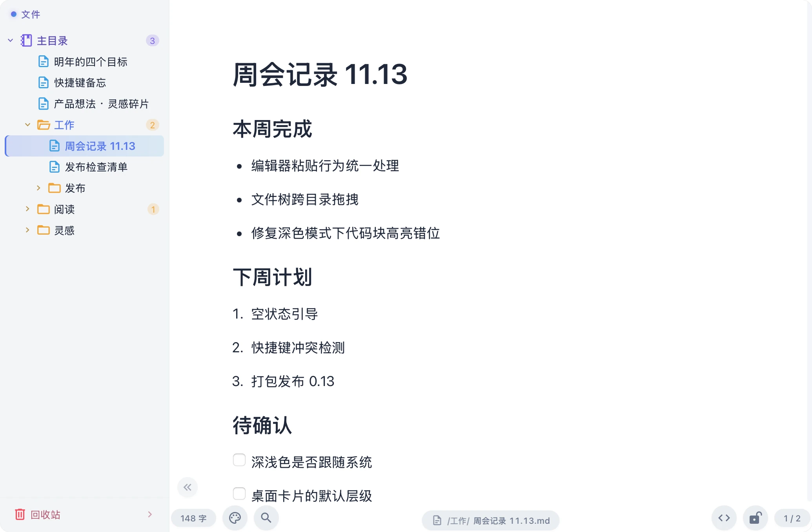
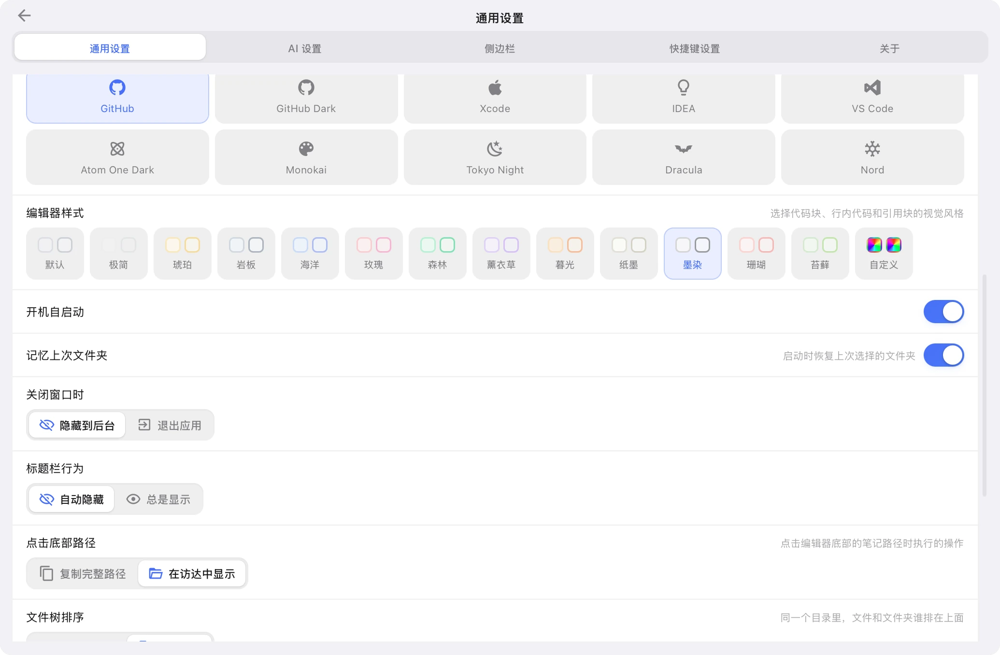
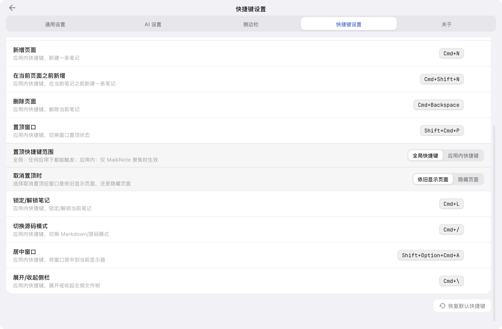
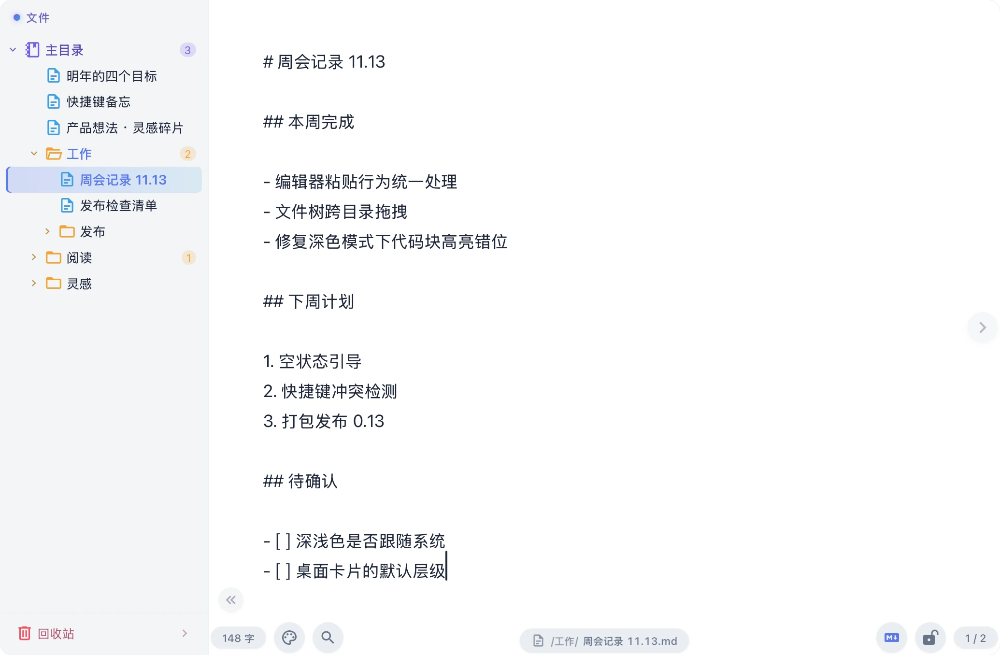
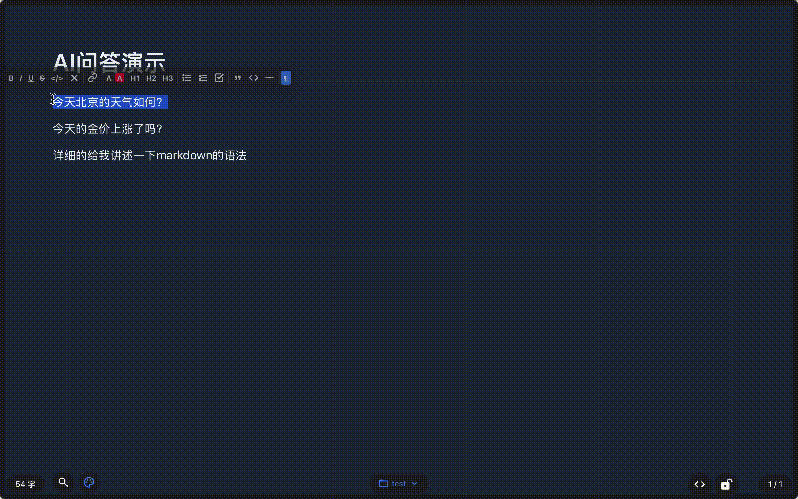

<div align="right">
  <a href="README.md">中文</a>
</div>

<div align="center">
  <h1>MaikNote</h1>
  <p>A native macOS floating note app for Markdown, with AI built in</p>
  <p>
    
    
    
    
    
  </p>
</div>

---

## About

Summon it with a global shortcut, write WYSIWYG Markdown, and keep every note as a plain `.md` file inside iCloud — so sync needs no account. AI rewriting and desktop note cards are built in. Inspired by [Antinote](https://antinote.io/) and extended with AI. The whole project is built with vibe coding.

Website & downloads: [maiknote.91kfc.vip](https://maiknote.91kfc.vip)

## Design Philosophy

**Come and go** · summon/hide anywhere with one shortcut ｜ **What you see is what you write** · live Markdown, no preview pane ｜ **No entities without need** · minimal UI, focus on content

## Screenshots




|              Folder               |              Search              |              Theme              |
|:--------------------------------:|:-------------------------------:|:-------------------------------:|
|  |  |  |

|               Palette               |               Shortcuts               |               Source mode               |
|:----------------------------------:|:------------------------------------:|:---------------------------------------:|
|  |  |  |

## AI Demo

> With a selection, only the selected text goes to the model; without one, the whole note does.



## Features

**Editing** — Notion-style block menu, block dragging, `/` slash commands; tables, task lists, syntax-highlighted code with copy, images and inline styles; source mode (`Cmd+/`) with in-source search; automatic link-card previews; font size, tab width and editor style presets; debounced autosave that round-trips empty paragraphs and CJK IME input without loss.

**Window & desktop** — borderless floating window with native vibrancy, adjustable opacity / always-on-top / layer; window position remembered per display and Space; **desktop note cards** (`Cmd+Shift+D`, draggable, resizable, checkbox write-back, three z-order modes); **edge panel** (a thin bar on any screen edge, four directions, adjustable width and colour); close-to-tray or quit, launch at login.

**Organization & search** — multi-level folder tree with sibling reordering and drag-into-folder moves; favorites and a pinned group; trash, note locking; frosted-glass global search (↑↓ / Enter / Esc); tree font size 11–18px; Markdown import / export.

**AI & integrations** — right-click AI rewrite (selection-aware); custom assistants and prompts, DeepSeek API by default; MCP web search; `/ip` for your egress IP; bundled `maiknote-guide` skill symlinked into Claude Code / Codex / DSH / Gemini CLI / `~/.agents`.

**Appearance & privacy** — dark / light / follow-system with several code themes; note background colour and default; first-run privacy page; Full Disk Access check and skill-link management in Settings; notes are real `<title>.md` files you can open and edit in Finder.

## Keyboard Shortcuts

| Shortcut | Action | Shortcut | Action |
|:---|:---|:---|:---|
| `Cmd+Opt+A` | Show / hide window (global) | `Cmd+Shift+D` | Pin to desktop / remove |
| `Shift+Opt+Cmd+A` | Center window (global) | `Cmd+F` | Search notes |
| `Cmd+N` | New note | `Cmd+,` | Open settings |
| `Cmd+Shift+N` | New note before current | `Cmd+L` | Lock / unlock note |
| `Cmd+Backspace` | Delete current note | `Cmd+/` | Toggle source mode |
| `Cmd+Shift+P` | Toggle always-on-top | `Cmd+\` | Toggle sidebar |
| `Cmd+[` / `Cmd+]` | Previous / next note | `Cmd+W` | Hide window / quit |
| `Cmd+Opt+[` / `Cmd+Opt+]` | Previous / next folder | `Esc` | Close search, leave settings |

> Everything except the global shortcuts can be rebound, cleared or reset in Settings → Shortcuts; two-finger horizontal scroll also switches notes.

## Data Storage

Notes live in iCloud as Markdown files — the file name is the title, folders are folders:

```
~/Library/Mobile Documents/com~apple~CloudDocs/MaikNote/
├── metadata.json        # index: favorites, locks, trash, order
├── assistants.json      # AI assistant configs
├── ideas.md
└── Work/
    └── weekly.md
```

The old flat `note_<uuid>.md` layout is migrated automatically on launch.

## Tech Stack

Tauri 2.x + Vue 3.x + TypeScript · Tiptap 2.x (Notion-style blocks) · Pinia · UnoCSS · plain `.md` files in iCloud · DeepSeek / OpenAI-compatible API · vue-i18n (Chinese / English)

## Development

Requires Node.js 20+, Rust 1.70+, macOS 12+.

```bash
npm install
npm run tauri dev                                          # dev
npm run tauri build -- --target aarch64-apple-darwin       # Apple Silicon
npm run tauri build -- --target x86_64-apple-darwin        # Intel
```

The marketing site lives in `site/` — plain static files, no build step.

## Troubleshooting

**"App cannot be opened"** — the app is not notarized; clear the quarantine flag: `sudo xattr -r -d com.apple.quarantine /Applications/MaikNote.app/`

**Notes are not visible in Finder** — grant Full Disk Access in System Settings → Privacy & Security, then click "Restart App" in MaikNote's settings.

## License

**Copyright © 2025-2026 MaikNote** · For personal study, research and private use only; commercial use of any kind is prohibited. Provided "as is", without warranty of any kind.

- ✅ Personal study, research and private use; modify the source for personal use; share for others' personal use (keep the copyright notice)
- ❌ Commercial use, integration into commercial products/services, selling / sublicensing, removing or altering copyright notices
